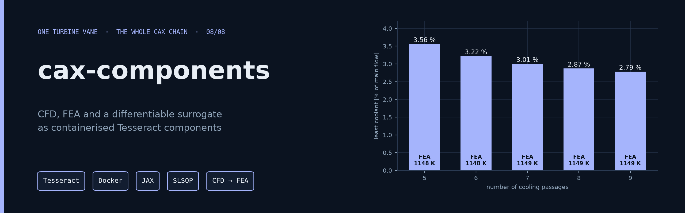
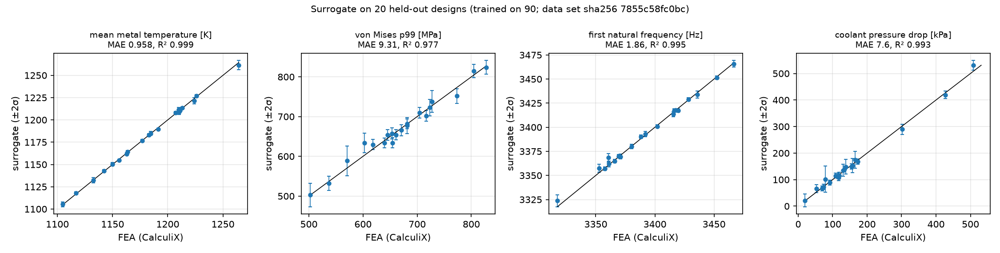
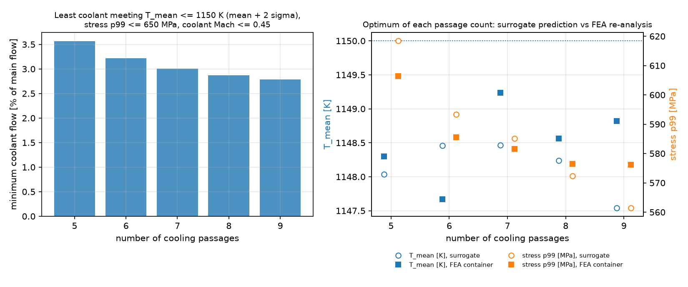

<!-- header:start -->
<p align="center">
  
</p>

<p align="center">
  <a href="https://github.com/ignaciofuertecarrasco/cax-components/actions/workflows/ci.yml"></a>
  
  
  
  
  <a href="LICENSE"></a>
</p>

<p align="center">
  <sub>Part of <a href="https://ignaciofuertecarrasco.github.io/cax-portfolio/"><b>One turbine vane, the whole CAX chain</b></a>: eight small open-source projects around one public turbine benchmark</sub><br>
  <sub><a href="https://github.com/ignaciofuertecarrasco/TurboAI">CFD</a> · <a href="https://github.com/ignaciofuertecarrasco/openfoam-viscous-work">viscous work</a> · <a href="https://github.com/ignaciofuertecarrasco/turboai-surrogates">surrogates</a> · <a href="https://github.com/ignaciofuertecarrasco/turboai-shape-ml">shape ML</a> · <a href="https://github.com/ignaciofuertecarrasco/turboai-damage">damage</a> · <a href="https://github.com/ignaciofuertecarrasco/turboai-agent">agent</a> · <a href="https://github.com/ignaciofuertecarrasco/vane-thermomech">CAD → FEA → CAM</a> · <b>components</b></sub>
</p>
<!-- header:end -->

**Legacy CAE solvers as containerised, schema-checked, differentiable software components.**

<!-- glance:start -->
## At a glance

| **3** | **11 min** | **0.96 K** | **1.3 K** |
|:-:|:-:|:-:|:-:|
| Docker images: OpenFOAM, CalculiX, JAX surrogate | CFD → FEA across two containers (1153.5 vs 1153.6 K) | surrogate error on held-out FEA designs | worst gap between predicted and FEA-verified optima |
<!-- glance:end -->


This repository wraps three simulation tools as components built with the open-source `tesseract-core`
toolkit and composes them into multi-physics, multi-container pipelines:

| Component | Wraps | Inputs → outputs | Differentiable |
|---|---|---|---|
| `cascade-cfd` | OpenFOAM `rhoSimpleFoam` (2D RANS, k-ω SST) via [TurboAI](https://github.com/ignaciofuertecarrasco/TurboAI) | blade shape (6 parameters + local bumps), operating point → loss, exit angle, mass flow, wall distributions; in heat-transfer mode the hot-gas table (T_aw, h) | no |
| `vane-fea` | CadQuery + gmsh + CalculiX via [vane-thermomech](https://github.com/ignaciofuertecarrasco/vane-thermomech) | cooling design (+ optional hot-gas table) → metal temperature, stresses, natural frequencies, surface fields | no |
| `vane-surrogate` | Gaussian processes in JAX, trained on `vane-fea` data | cooling design → T_max, T_mean, stress, f1, coolant Δp and Mach, with uncertainty | **yes** (JVP, VJP, Jacobian) |

Each component is a Docker image with a typed input/output schema (pydantic), a CLI, an HTTP API and an
OpenAPI description, built with `tesseract build`. Pipelines only exchange arrays, so a component can run
locally, on a cloud VM or on an HPC node (`Tesseract.from_url`) without changing the pipeline.

```
                          hot-gas table (x, y, p, T_aw, h, mass flow)
   ┌──────────────┐  ─────────────────────────────────────────────►  ┌──────────────┐
   │ cascade-cfd  │                                                   │   vane-fea   │──► dataset (HDF5)
   │  OpenFOAM    │                                                   │  CalculiX    │         │
   └──────────────┘                                                   └──────▲───────┘         │ train
                                                                             │ verify optimum   ▼
                                       jax.grad through the component  ┌─────┴──────────┐
                   SLSQP design loop ◄──────────────────────────────── │ vane-surrogate │
                                                                       │  JAX GP        │
                                                                       └────────────────┘
```

## Pipelines

* **`pipeline/cfd_to_fea.py`**: cross-physics chain across two containers. The CFD component runs the LS-89
  cascade at engine conditions in heat-transfer mode (adiabatic and isothermal runs on one mesh) and hands
  its hot-gas boundary-condition table to the FEA component, which computes the cooled vane's temperature,
  stresses and natural frequencies.
* **`pipeline/optimise_cooling.py`**: gradient-based design through a differentiable component. For each
  passage count, an SQP solver minimises the coolant flow subject to temperature, stress and coolant-Mach
  limits; gradients come from `jax.grad` through `tesseract_jax.apply_tesseract`, i.e. from the
  surrogate's vector-Jacobian-product endpoint. Limits are applied to mean + 2σ of the surrogate. The
  optimum is then re-analysed with the `vane-fea` container and the prediction compared with the
  simulation; the autodiff gradient is checked against finite differences.
* **`surrogate/train.py`**: turns the `vane-fea` design-sweep data set (HDF5 with a manifest and SHA-256,
  produced by `vanefea.campaign`) into the surrogate's `model.json`, with a held-out validation report
  (MAE, R², 95 % interval coverage). The model records the hash of the data it was trained on.

## Results

### CFD → FEA across two containers

`pipeline/cfd_to_fea.py` ran the LS-89 cascade at P0 = 10 bar, T0 = 1600 K, exit Mach 0.9 inside the
`cascade-cfd` image (adiabatic and isothermal OpenFOAM runs in parallel; loss coefficient 4.54 %, mass flow
14.71 kg/(s m), adiabatic wall temperature 1567-1605 K, heat transfer coefficient 0.6-3.4 kW/(m² K)) and passed
the table to the `vane-fea` image: mean metal temperature 1153.5 K, 99th-percentile stress 625 MPa, first
frequency 3420 Hz, energy balance 0.3 %, in 11 minutes end to end on a laptop. The same design analysed with
the table computed outside the container gives 1153.6 K and 625 MPa: the chain is reproducible across
environments.

### Surrogate and its validation



Trained on 90 of the 110 FEA designs of the vane-thermomech data set (SHA-256 recorded in `model.json`) and
tested on the other 20: mean metal temperature within 0.96 K on a 160 K range (R² 0.999), 99th-percentile stress
within 9 MPa (R² 0.977), first frequency within 1.9 Hz, coolant pressure drop within 7.6 kPa. The figure is
computed from the deployed `model.json`, not from the training session.

### Gradient-based cooling design, verified by the FEA container



For each passage count, SLSQP minimises the coolant flow with exact gradients through the surrogate component
(`jax.grad` → the component's VJP endpoint), subject to a mean metal temperature of at most 1150 K (applied to
mean + 2σ), a 99th-percentile stress of at most 650 MPa, a coolant Mach number of at most 0.45 and the
manufacturing margins. Starting points are the training designs with the same passage count plus random points.
Four passages cannot meet the temperature limit; from five to nine passages the required coolant falls from 3.56 %
to 2.79 % of the main flow (the baseline design of vane-thermomech uses 3 % and runs at 1154 K).

Every optimum was then re-analysed by the `vane-fea` container: the mean temperature agrees with the prediction
within 1.3 K and stays below the limit in all five cases (1147.7-1149.2 K), the stress within 3-15 MPa. The
autodiff derivative ∂T_mean/∂coolant through the component (-4693.264 K) matches central finite differences to
seven significant digits. Optimisation: 18 minutes for 5 passage counts; verification: about 3 minutes per FEA
design.

## Design notes

* **Schemas as contracts.** Inputs are validated before any solver starts: the FEA component rejects a
  cooling layout that violates the wall-thickness or ligament constraints, the CFD component a blade that
  self-intersects. Units are in the field descriptions of the OpenAPI schema.
* **Legacy-solver hygiene.** The CFD image sources OpenFOAM's environment inside the Python process (the
  Tesseract runtime does not use a login shell) and loads the project's compiled fvOption (`viscousWork`,
  which adds viscous heating to `rhoSimpleFoam`'s energy equation) through `LD_LIBRARY_PATH`.
  Every solver call checks that the job really finished (CalculiX's `Job finished`, OpenFOAM's `End`)
  rather than trusting the exit code.
* **Gradients where they are cheap and exact.** The CFD and FEA solvers are not differentiated: their
  adjoints would cost more than the whole study. The design loop differentiates the surrogate exactly, and
  the expensive solvers are used where they are irreplaceable, to generate the data and to verify the answer.

## Quick start

**Run the published component, no installation beyond Docker.** The surrogate image is built and pushed by
GitHub Actions on every change ([workflow](.github/workflows/publish-image.yml)):

```bash
docker pull ghcr.io/ignaciofuertecarrasco/vane-surrogate:latest
docker run --rm ghcr.io/ignaciofuertecarrasco/vane-surrogate:latest apply   '{"inputs": {"n": 7, "ratio": 0.4, "f_start": 0.1, "f_end": 0.8, "coolant": 0.03}}'
# -> T_mean 1152.8 K, T_max 1569.6 K, f1 3420 Hz (FEA of the same design: 1154 K, 1570 K, 3421 Hz)
docker run --rm ghcr.io/ignaciofuertecarrasco/vane-surrogate:latest --help     # all endpoints: apply, jacobian, vjp, serve ...
```

**Build everything locally.** Requirements: Docker, Python ≥ 3.10, `pip install tesseract-core tesseract-jax "jax[cpu]" equinox`.
The solver packages are built into the images as wheels from their repositories, expected next to this
one (`../TurboAI`, `../vane-thermomech`; override with `TURBOAI_SRC`, `VANEFEA_SRC`).

```bash
bash scripts/build.sh                       # vane-surrogate, vane-fea, cascade-cfd
tesseract run vane-fea apply '{"inputs": {"n_passages": 7, "diameter_ratio": 0.4}}'
tesseract serve vane-surrogate              # HTTP API + OpenAPI schema
python pipeline/optimise_cooling.py         # gradient-based design + FEA verification
python pipeline/cfd_to_fea.py               # OpenFOAM -> CalculiX across containers
```

The surrogate component is also tested from source, without Docker (`pytest tests`), which is what the
CI does on every push; a second CI job builds the images and runs the FEA component on its default design.

## Repository layout

```
cax-components/
├── tesseracts/
│   ├── cascade_cfd/      OpenFOAM cascade CFD component (tesseract_api.py, config, requirements)
│   ├── vane_fea/         CadQuery + gmsh + CalculiX vane FEA component
│   └── vane_surrogate/   differentiable JAX Gaussian-process component (model.json, validation.json)
├── pipeline/
│   ├── cfd_to_fea.py         OpenFOAM -> CalculiX across two containers
│   └── optimise_cooling.py   gradient-based cooling design, verified by the FEA component
├── surrogate/            training and validation of the surrogate on the vane-thermomech data set
├── scripts/build.sh      builds the three images
├── results/              outputs of the pipelines and figures
└── tests/                the surrogate component tested from source (schema, apply, gradients)
```

<!-- footer:start -->
## The series

| # | Project | Question |
|:-:|---|---|
| 1 | [TurboAI](https://github.com/ignaciofuertecarrasco/TurboAI) | OpenFOAM CFD of a transonic vane, checked against the wind tunnel, with a Python API |
| 2 | [openfoam-viscous-work](https://github.com/ignaciofuertecarrasco/openfoam-viscous-work) | Viscous heating in the rhoSimpleFoam energy equation, added as an fvOption |
| 3 | [turboai-surrogates](https://github.com/ignaciofuertecarrasco/turboai-surrogates) | How few CFD runs does a millisecond surrogate need? |
| 4 | [turboai-shape-ml](https://github.com/ignaciofuertecarrasco/turboai-shape-ml) | Gaussian processes or a graph network over blade shape? Design checked by CFD |
| 5 | [turboai-damage](https://github.com/ignaciofuertecarrasco/turboai-damage) | Where does a 0.4 mm defect hurt, and can a model tell without CFD? |
| 6 | [turboai-agent](https://github.com/ignaciofuertecarrasco/turboai-agent) | The toolbox as typed tools for an LLM agent (MCP) |
| 7 | [vane-thermomech](https://github.com/ignaciofuertecarrasco/vane-thermomech) | CAD → mesh → thermal, static and modal FEA of the cooled vane, CAM, ML data set |
| 8 | **cax-components** (this one) | CFD, FEA and a differentiable surrogate as Tesseract components |

Overview page: https://ignaciofuertecarrasco.github.io/cax-portfolio/

## License

MIT, see [LICENSE](LICENSE). The LS-89 geometry and measurements are from T. Arts et al., VKI TN-174 (1990).
<!-- footer:end -->
